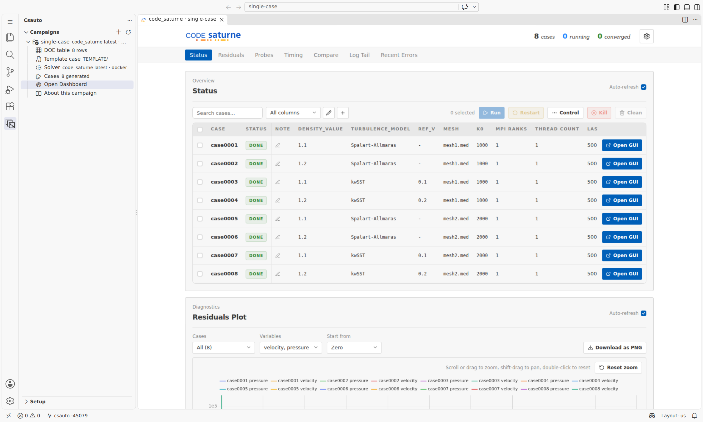

<p align="center"></p>

<p align="center">
  <a href="https://simvia-tech.github.io/csauto/"></a>
  <a href="/"></a>
  <a href="https://github.com/simvia-tech/csauto/actions/workflows/pr.yml"></a>
  <a href="./LICENSE"></a>
</p>

# csauto

## Description

**csauto** automates [code_saturne](https://www.code-saturne.org/) CFD and [code_aster](https://www.code-aster.org/) finite-element simulation campaigns.
It offers:

- Generation of tens or hundreds of cases from one template + one CSV, in seconds
- Local and Slurm job execution with status tracking
- A web dashboard for monitoring job status, logs, and errors in real time, plus residuals, probes, and timings for code_saturne
- Input file comparison and cleanup utilities, plus restart from checkpoint and live case steering (stop/extend/checkpoint without killing) for code_saturne

No manual case duplication. No directory juggling. Just simulations.



## Installation

### VS Code extension (recommended)

csauto ships as a VS Code extension that embeds the dashboard directly in the editor, including over [Remote-SSH](https://code.visualstudio.com/docs/remote/ssh) sessions on HPC clusters. It manages its own Python environment: no manual csauto install needed (Python 3.11+ must be available on the machine).

1. Download the `.vsix` for your platform from the [releases page](https://github.com/simvia-tech/csauto/releases) and install it via **Extensions: Install from VSIX** (marketplace publication is planned): `linux-x64` for most Linux machines and WSL, `linux-arm64`, `darwin-arm64` for Apple silicon Macs, `darwin-x64` for Intel Macs. These carry csauto's Python dependencies and set up offline; the generic `csauto-<version>.vsix` downloads them from PyPI instead. With Remote-SSH or WSL, pick the platform of the remote side. Windows is supported through WSL.
2. Open a folder, click the **csauto** icon in the activity bar, and create a campaign with **New Campaign…** (the + button), or open the dashboard of a campaign the folder already holds. The first use sets up the private runtime.
3. Optional: use **Install csauto CLI** in the sidebar to also get the `csauto` command in your terminal.

### Headless / HPC without VS Code (CLI + browser)

For machines where VS Code isn't an option, install the CLI directly; the same dashboard is then available in your browser via `csauto serve`. Requires **Python 3.11+**; core features have **no external dependencies** (pure standard library), the web dashboard needs a few extra packages (installed by the script).

```bash
# One-line install (latest release into ~/.local/share/csauto, with a venv and a shell alias)
bash -c "$(curl -fsSL https://raw.githubusercontent.com/simvia-tech/csauto/main/install.sh)"

# Reload your shell
source ~/.bashrc   # or: source ~/.zshrc
```

To update an existing installation, re-run the same command: it installs the latest release over the existing one. Neither git nor Node.js is needed.

Alternatively, each [release](https://github.com/simvia-tech/csauto/releases) ships a self-contained wheel (dashboard included) for scripted or CI installs:

```bash
pip install "csauto-<version>-py3-none-any.whl[web]"
```

<details>
<summary>Manual installation (for contributors or custom locations)</summary>

```bash
git clone https://github.com/simvia-tech/csauto.git ~/tools/csauto
cd ~/tools/csauto

# Option A: use the install script (creates venv, adds alias)
./install.sh

# Option B: manual setup
python3 -m venv .venv && source .venv/bin/activate
pip install -e ".[web]"

# Build the dashboard once (a clone does not include it; needs Node.js and pnpm)
cd frontend && pnpm install && pnpm build
```

The `csauto` command is available inside the venv. To use it globally, add an alias:

```bash
echo "alias csauto='$HOME/tools/csauto/.venv/bin/csauto'" >> ~/.bashrc
```

To install without a venv: `./install.sh --no-venv`

</details>

Verify:

```bash
csauto --help
```

### Prerequisites

You need at least one runtime for your solver:

| Runtime       | Requirement                                      |
|---------------|--------------------------------------------------|
| `native`      | The solver's executable (`code_saturne`, or `run_aster` for code_aster) in PATH or set via `solver_bin` |
| `singularity` | Apptainer/Singularity + a `.sif` image           |
| `docker`      | Docker engine; the image defaults to the solver's own (`simvia/code_saturne`, `simvia/code_aster:17.4.0`) |

## Usage

> **First time?** Follow the [Quickstart guide](docs/quickstart.md) for a complete walkthrough from zero to a running campaign.

```bash
# 0. (Optional) Generate doe.csv from a parameter spec instead of hand-writing it
csauto doe spec.toml doe.csv --method lhs --samples 40 --seed 42

# 1. Generate cases from your DOE and template
csauto prepare doe.csv TEMPLATE RUNS

# 2. Validate environment
csauto doctor RUNS

# 3. Launch the web dashboard
csauto serve RUNS --host 127.0.0.1 --port 8000
```

Open [http://127.0.0.1:8000](http://127.0.0.1:8000), then launch runs from the **Status** panel: `Ctrl+A` → **Run**.

See [docs/doe-format.md](docs/doe-format.md) for the `doe.csv` format and the `csauto doe` generator (factorial/LHS/Sobol/CCD).

### Example project layout

```
my-campaign/
├── csauto.toml
├── doe.csv
├── TEMPLATE/
│   └── DATA/
│       └── setup.xml      ← uses {u_inlet}, {turbulence_model}, etc.
└── RUNS/                  ← generated by csauto prepare
    ├── registry.json
    ├── campaign.json      ← the solver the campaign was prepared for
    ├── case0001/
    └── case0002/
```

The solver defaults to code_saturne. For code_aster, set `solver = "code_aster"` in `csauto.toml` and see [examples/codeaster-cube](examples/codeaster-cube/README.md). Later commands on `RUNS` use the solver recorded in `RUNS/campaign.json`, from any directory.

### CLI commands

The web UI (`csauto serve`) is the primary interface for runtime monitoring and operations: launching, steering, killing, restarting, comparing, and inspecting cases. The CLI covers initial setup (`prepare`, `doctor`), data export (`residuals`, `perf`), and offers terminal alternatives for common actions.

| Command     | Description                                       | UI equivalent              |
|-------------|---------------------------------------------------|----------------------------|
| `prepare`   | Generate cases from a DOE CSV and a template      | CLI only                   |
| `doe`       | Generate a `doe.csv` from a parameter spec (factorial/LHS/Sobol/CCD) | CLI only |
| `doctor`    | Validate runtime environment and configuration    | CLI only                   |
| `serve`     | Start the web monitoring dashboard                | Starts the UI              |
| `run`       | Launch cases locally or on Slurm (`--n`, `--nt` required) | Status → Run       |
| `status`    | Show case status in the terminal                  | Status panel               |
| `tail`      | Stream a case log file (like `tail -f`)           | Log Tail panel             |
| `control`   | Send a live control action to a running case (code_saturne: stop, extend, checkpoint, flush) | Status → Control menu |
| `kill`      | Kill running cases immediately                    | Status → Kill |
| `note`      | Set or clear a case note                          | Status → Note column         |
| `convergence` | Mark a finished case converged / not converged  | Status → Convergence menu |
| `residuals` | Export residuals data and/or SVG plot             | Residuals Plot panel       |
| `perf`      | Export the solver's timing metrics                | Timing Snapshot panel      |
| `cleanup`   | Remove old run folders, truncate logs (`--prune-resu`, etc.) | Status → Clean  |

Utility commands: `csauto completion bash|zsh` (shell completion) and `csauto enable-telemetry` / `disable-telemetry`.

The web UI also provides features beyond the CLI: edit case files, compare runs side-by-side, plot probes/profiles, and scan logs for recent errors.

## VS Code extension

The extension is the primary way to use csauto. It runs the csauto server in the background on a free port and embeds the dashboard in an editor panel. Over Remote-SSH sessions, VS Code forwards the port automatically.

A **campaign** is a folder holding a template case (`TEMPLATE/`), a DOE table (`doe.csv`, one row per case, one column per `{placeholder}` of the template) and a `csauto.toml` naming its solver and runtime. csauto generates one case per row into `RUNS/`, runs them, and follows them in the dashboard.

**New Campaign…** (the + button of the Campaigns view) opens a page in the editor that fills top to bottom:

1. **Solver**: every installed solver adapter is offered.
2. **Start from**: the solver's example (ready to run), **my files**, a case folder you already have, or nothing (an empty `TEMPLATE/` to fill yourself).
3. **Your files**: one picker per input the solver needs. code_aster asks for the command file (`.comm`), the meshes, and optionally an `.export`: csauto writes one for the picked files (meshes read with `UNITE=20, 21...` in the order picked, MED results of `IMPR_RESU` saved under `RESU/`) or points yours to them. code_saturne asks for the setup file (it becomes `DATA/setup.xml`), the meshes, and optionally `run.cfg` and user sources. Meshes go to the campaign's shared `MESH/` folder.
4. **Parameters**: the `{placeholders}` found in your files, and a table with one row per case (paste rows from a spreadsheet or a CSV file into any cell). A case without placeholders gets one `baseline` case that runs it as is: to vary a value across cases, replace it with `{name}` in your files and add a `name` column to `doe.csv`.
5. **Campaign**: the folder name (a free one is suggested), the runtime (those found on your machine are marked) and the solver version (a docker image tag: the installed ones, then every tag on Docker Hub with its size and date, downloaded when the campaign is created; the native executable; or a `.sif` image), and whether to generate the cases right away.

The **Campaigns** view shows one row per campaign, with its solver and version, and a Dashboard button once its cases exist. Expanding a campaign shows its steps:

- **DOE table** (its row count) and **Template case**: open them to edit the study.
- **Solver**: the version and runtime; click to change them (the dashboard server restarts to apply it). A warning appears here when the environment check finds a problem.
- **Cases**: what is left to generate ("2 new rows"); click to run `csauto prepare`, which keeps the cases already generated.
- **Open Dashboard**, and **About this campaign** when the folder has a README.

Right-click a campaign for the rest: Check Environment, Edit csauto.toml, Reveal in Explorer, Stop Dashboard Server (while it runs), Restart Dashboard Server, Show Server Logs, **Delete Generated Cases…** (moves `RUNS/` to the trash) and **Delete Campaign…** (moves the whole folder to the trash). Both refuse while cases are running or queued. Dashboard servers start when a dashboard opens (a campaign's row shows an open folder icon while its server runs), and **csauto: Stop All Servers** in the command palette stops them all.

Multiple campaigns (even different solvers) can have their dashboards open side by side, each backed by its own server and `csauto.toml`, with panels titled by solver and campaign. Palette commands ask which campaign to act on when the workspace has more than one.

The **Setup** view (collapsed, with a badge when something needs attention) holds:

- the **Setup Guide**, the extension version, the managed runtime state (click to set it up), **Install csauto CLI** (a `csauto` shim in `~/.local/bin` backed by the extension's managed runtime), the extension logs, and the `csauto.*` settings.

**Run notifications**: a notification fires when a running case finishes (DONE or FAILED) in any campaign, with a shortcut back to its dashboard (disable via `csauto.notifyOnRunCompletion`).

On first use the extension creates a private Python environment (in extension storage) and installs its bundled csauto into it, so extension and engine versions never drift. Its dependencies come from the wheels bundled in the platform's `.vsix` (offline), or from PyPI with the generic package or a Python newer than those bundled.

**Setup Guide** (a VS Code walkthrough, opened on install and from the Setup view or **csauto: Open Setup Guide**) checks what csauto needs on the machine, one step each with a fix: Python 3.11 or newer, Python's `venv` module (a separate `python3.X-venv` package on Debian and Ubuntu), csauto's environment (a **Set up csauto** button), then the solvers, ticked once code_aster or code_saturne can run (Docker running, the solver on the PATH, or Apptainer/Singularity), then a first campaign. On Windows, csauto runs in WSL: the guide starts with opening a WSL window. Settings under `csauto.*`: `pythonPath` (bring your own interpreter instead of the managed runtime), `port` (0 = auto), `serveArgs`, `notifyOnRunCompletion` (a notification when cases finish or fail) and `enableTelemetry`.

To develop the extension (full guide: [DEVELOPMENT.md](./DEVELOPMENT.md)): `npm install`, `npm run watch` (esbuild + tsc + frontend rebuild in parallel), then press F5 to launch an Extension Development Host. In dev mode the managed runtime uses an **editable install** of the checkout, so Python changes are live after "Restart Server" and dashboard changes after "Reload Dashboard" (the watch task rebuilds `csauto/_frontend` automatically). `npm run package` produces the production bundle; `npm run bundle` builds the wheel shipped in the `.vsix`; `npx @vscode/vsce package` builds the `.vsix` itself; `scripts/package-all.sh` builds every per-platform `.vsix`, and `scripts/publish.sh` builds and publishes them all to the Marketplace.

## Troubleshooting

Run `csauto doctor RUNS` to diagnose common issues (missing runtimes, broken paths, configuration errors).

For more details, see the [troubleshooting guide](docs/troubleshooting.md).

## Telemetry

csauto collects anonymous usage statistics to help us understand how the tool is used and prioritize improvements. No personal data, file paths, simulation data, or case names are ever sent.

**What is collected:**

- A random anonymous identifier (persistent across sessions, shared by the CLI and the extension)
- csauto version (the extension's version for extension events)
- Timezone offset
- The event type, whether it succeeded, and a short context: the solver (code_saturne or code_aster), and the runtime (docker, singularity, or native) for the CLI or where VS Code runs (local, WSL, SSH remote...) for the extension
- For a finished simulation run, its duration

**When it is sent:**

- From the VS Code extension: when it activates in a window, when a campaign is created, and when a simulation run finishes (DONE or FAILED)
- From the CLI without VS Code: once during install or update (`install.sh`), and once when `csauto serve` starts, then a daily heartbeat while it runs

**How to opt out:**

In VS Code, turn off `csauto.enableTelemetry`, or VS Code's own telemetry (`telemetry.telemetryLevel`): either one also silences the servers the extension starts. Elsewhere:

```bash
# Via the CLI
csauto disable-telemetry

# During installation
./install.sh --no-telemetry

# Via the web UI
# Open Settings (gear icon) and uncheck "Send anonymous usage statistics"
```

To re-enable: `csauto enable-telemetry`

## Documentation

- [Quickstart](docs/quickstart.md)
- [Core concepts](docs/concepts.md)
- [Web UI guide](docs/web-ui.md)
- [CLI reference](docs/cli.md)
- [Configuration](docs/config.md)
- [DOE format](docs/doe-format.md)
- [Run lifecycle](docs/run-lifecycle.md)
- [HTTP API](docs/api.md)
- [Task cookbook](docs/task-cookbook.md)
- [Limitations](docs/limitations.md)
- [Adding a new solver](docs/adding-a-solver.md)

## Contributing

Please check out our [CONTRIBUTING.md](./CONTRIBUTING.md) file if you want to contribute to the project.

Merge requests adding support for new solvers are gladly welcome. csauto knows a solver through one adapter class that says how to start it, where its files are, and how to read its output: [docs/adding-a-solver.md](docs/adding-a-solver.md) walks through writing, registering, and testing one.

Thank you to all our contributors :

- Ulysse Bouchet - [Email](mailto:ulysse.bouchet@simvia.tech)
- Florian Hermet - [Email](mailto:florian.hermet@simvia.tech)

## Development

Setting up the extension, running it with F5 and debugging each layer is covered in [DEVELOPMENT.md](./DEVELOPMENT.md).

```bash
# Install with dev + web dependencies
pip install -e ".[dev,web]"

# Run full test suite
pytest -q

# Run by scope
pytest tests/unit -q
pytest tests/integration -q
pytest tests/web -q

# Run a single test
pytest tests/unit/test_foo.py::test_bar -q

# Real runs of the shipped examples in docker (opt-in, needs the solver images)
CSAUTO_DOCKER_TESTS=1 pytest tests/integration/test_docker_solvers.py -q
```

### Frontend development

The web dashboard is a SvelteKit app in `frontend/`. It builds into `csauto/_frontend/`, which git ignores: CI builds it for the wheel and the `.vsix`, so users never need Node.js. In a clone, build it once before running `csauto serve`.

To work on the frontend:

```bash
# Install dependencies (requires Node.js and pnpm)
cd frontend && pnpm install

# Start the dev server (hot reload, proxies /api to the backend)
pnpm dev

# In another terminal, start the backend
csauto serve RUNS

# Build for production (into csauto/_frontend/)
pnpm build
```

See [architecture](docs/architecture.md) for an overview of the codebase.

## See Also

- [code_saturne](https://www.code-saturne.org/) and [code_aster](https://www.code-aster.org/): the open-source solvers csauto automates
- [Simvia's website](https://simvia.tech)

## License

This project is licensed under the GNU General Public License version 3 (GPL-3.0).
See the full license text in the [LICENSE](./LICENSE) file.

- **Summary:** You are free to use, copy, modify, and redistribute this software.
- **Conditions:** Redistributions and derivative works must be licensed under GPL-3.0 and include source or a written offer to provide the source.
- **More information:** https://www.gnu.org/licenses/gpl-3.0.en.html

## Contact Us

Contact us at [ulysse.bouchet@simvia.tech](mailto:ulysse.bouchet@simvia.tech) or [florian.hermet@simvia.tech](mailto:florian.hermet@simvia.tech).
